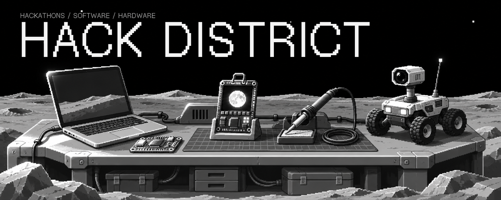
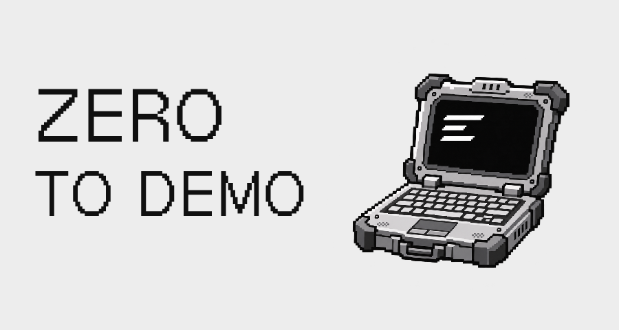
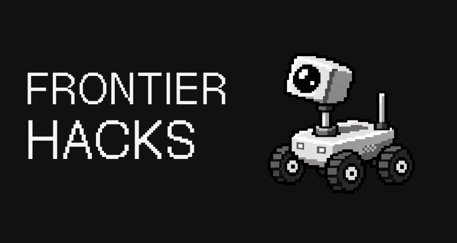

<picture>
  <source media="(max-width: 600px)" srcset="https://raw.githubusercontent.com/Hack-District/.github/main/profile/assets/v2/welcome-compact.webp" />
  
</picture>

<a href="https://luma.com/6vb82jnj">Zero to Demo</a> · <a href="https://frontierhacks.com">FrontierHacks</a> · <a href="#community">Community</a>

## A community for people who build.

We bring new and experienced builders together through hackathons and hands-on projects. Find collaborators, explore an idea, and make something you can show: a working demo, a useful tool, or a piece of hardware.

## Events

<table>
  <tr>
    <td width="50%" valign="top">
      
      <h3>Zero to Demo</h3>
      
A free, beginner-friendly AI hackathon by <b>NemulAI × Hack District</b>. Build your first demo, solo or with a team.

      
<a href="https://luma.com/6vb82jnj">Details &amp; registration</a>

    </td>
    <td width="50%" valign="top">
      
      <h3>FrontierHacks</h3>
      
Our <b>Bay Area</b> AI hackathon. Find collaborators, explore an idea, and build toward a live demo. Follow the official site for updates.

      
<a href="https://frontierhacks.com">Event website</a> · <a href="https://luma.com/vcnvkluj">Luma</a>

    </td>
  </tr>
</table>

## What we build

- **Web &amp; AI:** The websites, tools, and creative experiments around our events.
- **Badge hardware:** Electronic crew badges, from circuit design to prototypes in development.
- **Lunar Arcade:** A moon-and-space interface, games, and offline tools for the badge project.

## Community

Meet builders and follow event updates in the [FrontierHacks Discord](https://discord.gg/XfrNbzDbG). Mentor, contribute tools, or help host through [FrontierHacks partnerships](https://frontierhacks.com/sponsors/).
