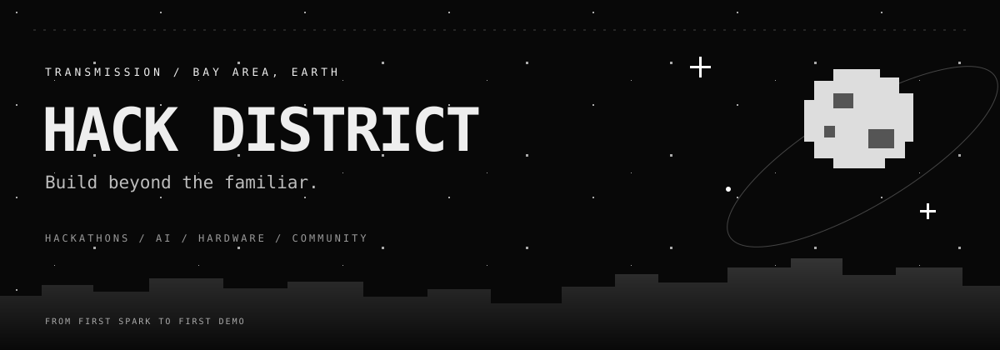
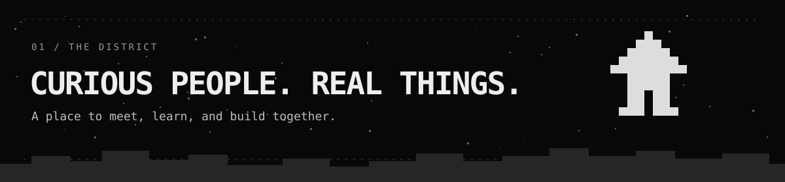
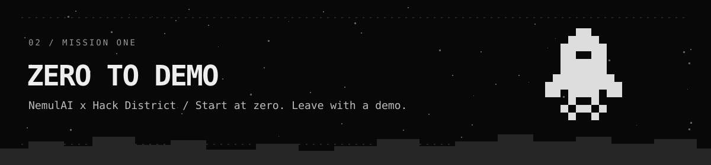
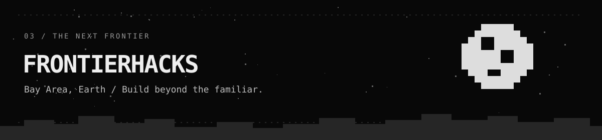
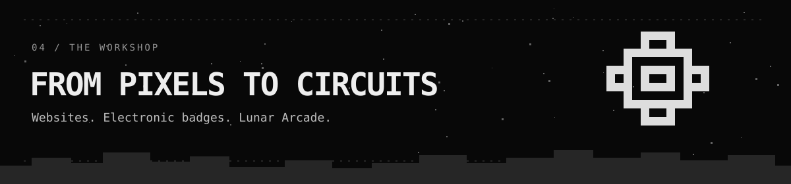
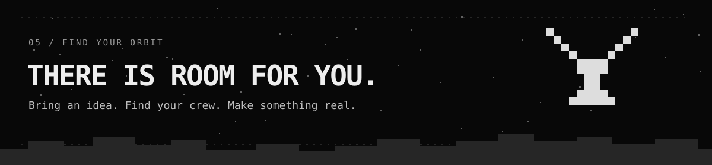

<a href="https://frontierhacks.com">FRONTIERHACKS ↗</a> · <a href="https://luma.com/6vb82jnj">ZERO TO DEMO ↗</a> · <a href="https://discord.gg/XfrNbzDbG">JOIN THE CREW ↗</a>

<b>A place for curious people to make something real.</b> Hackathons. First prototypes. Unexpected collaborators. The next idea.

We're **Hack District** — a community bringing builders together through hackathons, creative experiments, and hands-on projects. We care about the moment an idea becomes something you can show: a useful AI tool, a playful interface, a working demo, or a piece of hardware you can hold.

From **Zero to Demo**, presented with **NemulAI**, to the next chapter at **FrontierHacks**, we're making room for people to meet, learn, and build together.

**Come with curiosity. Find your people. Give the idea a first version.**

**Start at zero. Leave with a demo.**

A free, beginner-friendly Bay Area AI hackathon presented by **NemulAI × Hack District**. First-time builders, creatives, developers, and engineers are welcome; no prior coding experience is required.

Come solo or with a team. Explore an idea, get feedback, and build toward something you can demonstrate.

**Four tracks:** Automate · Impact · Create · Frontier

[Event details & registration ↗](https://luma.com/6vb82jnj)

**Build beyond the familiar.**

Our upcoming AI hackathon in the **Bay Area, California**, planned as the next event following Zero to Demo. A gathering for curious minds exploring what AI makes possible.

Meet collaborators, experiment with an idea, and bring your project to the demo stage.

**Date & venue:** to be announced. Follow the official event page for confirmed details.

[Explore the website ↗](https://frontierhacks.com) · [Luma ↗](https://luma.com/vcnvkluj)

Our GitHub is home to the work behind the events, too.

| Project | What we're building |
| :--- | :--- |
| **FrontierHacks website** | A monochrome lunar world for the event, its community, and the next wave of builders. [Visit the site ↗](https://frontierhacks.com) |
| **Zero to Demo badge hardware** | Reusable electronic crew badges, with KiCad designs and manufacturing review documentation. |
| **Zero to Demo badge firmware** | Lunar Arcade: a moon-and-space interface, games, identity, and offline owner tools for the badges. |

The badge projects are in engineering review; physical prototype qualification is still open. Project repositories are currently private.

**FROM FIRST SPARK TO FIRST DEMO**

**IDEA** → **CREW** → **PROTOTYPE** → **DEMO** → **KEEP GOING**

   

- **Build with us:** explore [Zero to Demo](https://luma.com/6vb82jnj) and [FrontierHacks](https://frontierhacks.com).
- **Meet the community:** join the conversation on [Discord](https://discord.gg/XfrNbzDbG).
- **Partner or mentor:** help with tools, time, prizes, or a place to gather. [Partner with FrontierHacks ↗](https://frontierhacks.com/sponsors/)

---

HACK DISTRICT · BAY AREA, EARTH  <b>Somewhere between “what if” and “look at this.”</b> See you at the next frontier. ✦

